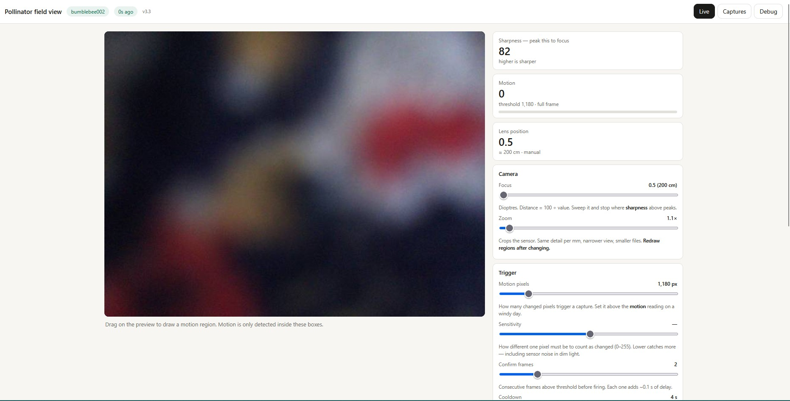
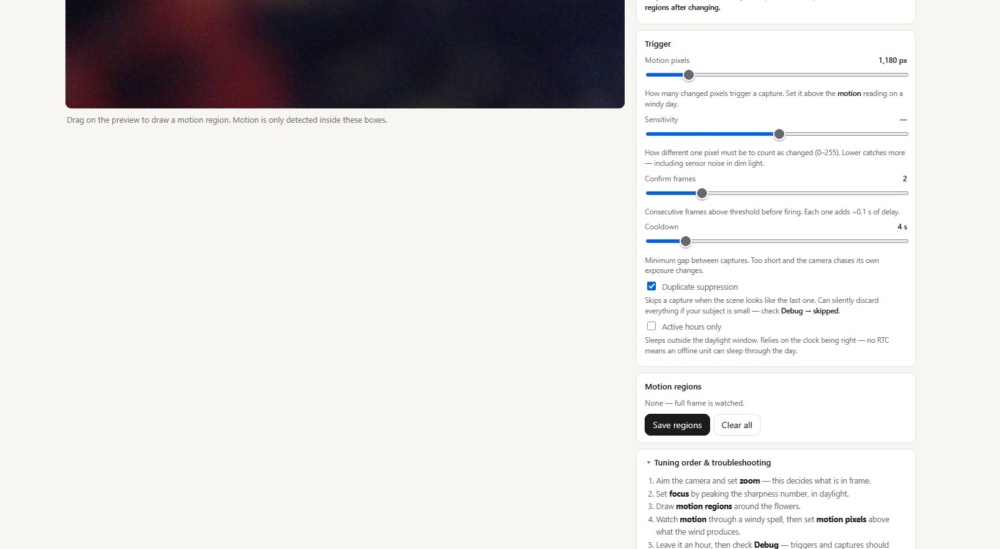
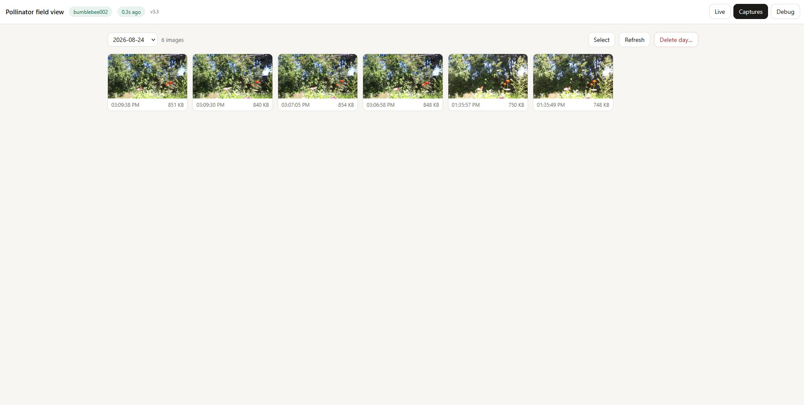
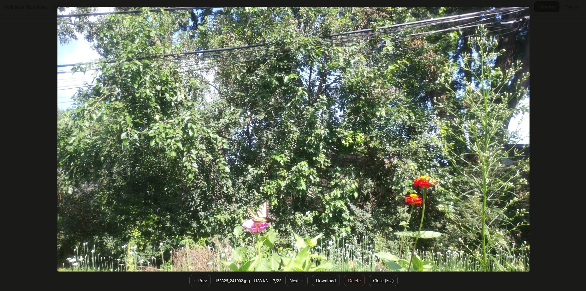
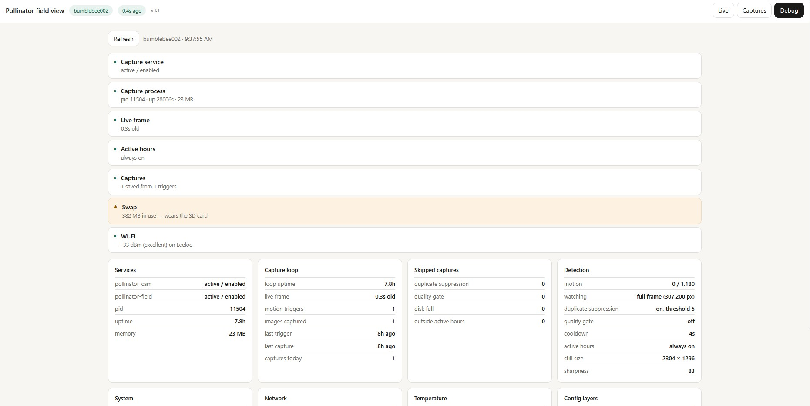
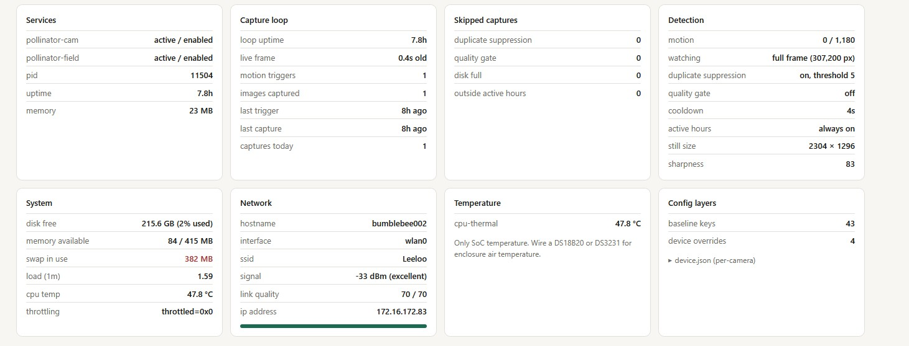

# bumblebee-cam

Motion-triggered field cameras that photograph pollinators visiting flowers,
built for the CBG Conservation Genomics group. Each camera is a Raspberry Pi
Zero 2 W with a Camera Module 3. It watches regions you draw around a flower
and takes a 2304x1296 photo when something moves there. The photos are then
labelled and identified on a laptop. Nothing runs AI on the Pi.

**New to the project? Read [HANDOFF.md](HANDOFF.md).**

## What's here

| Path | What it is |
|---|---|
| `src/pollinator_cam.py` | Capture service: motion detection + stills |
| `src/pollinator_field.py` | Field web UI on port 8020 (Live / Captures / Debug) |
| `src/pollinator_live.py` | Publishes the live frame + counters to `/run/pollinator` |
| `src/pollinator_common.py` | Shared helpers, config loading, code defaults |
| `config/` | `baseline.json` (all cameras) and `device.json.example` (per camera) |
| `systemd/` | The two services and their drop-ins |
| `ops/` | Cron scripts: health log and Wi-Fi watchdog |
| `install.sh` | Sets up a fresh Pi |
| `Makefile` | Deploy commands (`make help`) |

## Quick start

```bash
sudo apt install -y git make
git clone https://github.com/VictorMisyutin/bumblebee-cam.git && cd bumblebee-cam
sudo ./install.sh
```

Then open `http://<hostname>.local:8020` to aim, focus and draw motion regions.

Config is layered, and the rightmost layer wins:
`code defaults → /etc/pollinator/baseline.json → /etc/pollinator/device.json`

## Screenshots







